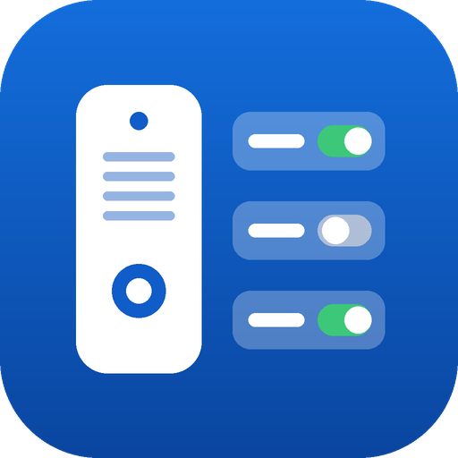

<p align="center">
  
</p>

# Advanced UniFi Access Directory

🇬🇧 [English README](README.md)

Benutzerdefinierte Home-Assistant-Integration zur Verwaltung des **Intercom-Verzeichnisses von UniFi Access**.
Sie legt fest, wer klingelt, wenn ein Besucher am UniFi-Intercom einen Raum anruft oder die Türklingel drückt.

Pro Raum lassen sich Viewer, Chimes, Benutzer und Telefonnummern hinzufügen oder entfernen.
Räume lassen sich anlegen und löschen, Anrufzeitpläne setzen. Das alles geht über die
Home-Assistant-Oberfläche, über Automationen oder über Skripte.

Die Integration spricht **direkt und lokal** per HTTPS mit deiner UniFi-OS-Konsole (UDM, UNVR, UCG, …).
Sie braucht keine Cloud und keinen UI.com-Account.

> [!WARNING]
> Die Integration nutzt die **interne, undokumentierte API** des UniFi-Access-Web-UI.
> Ubiquiti kann sie mit jedem Access-Update ohne Ankündigung ändern. Änderungen werden
> direkt in deine Access-Konfiguration geschrieben. Nutzung auf eigene Gefahr, siehe [Haftungsausschluss](#haftungsausschluss).

---

## Funktionen

- 🔀 **Schalter pro Raum × Empfänger**: `an` bedeutet, dass der Empfänger für diesen Raum klingelt.
- 🔔 **Türklingel-Direktruf**: Auch die Empfänger des Klingelknopfs sind Schalter.
- 🏠 **Räume**: Räume per Service anlegen und löschen.
- 🗓️ **Zeitpläne**: Benutzerdefinierter Wochenplan pro Empfänger oder Rücksetzen auf „Immer“.
- ♻️ **Zeitplan-Wiederherstellung**: Access löscht beim Entfernen eines Empfängers dessen privaten Zeitplan. Die Integration sichert ihn und stellt ihn beim erneuten Hinzufügen wieder her.
- 🔍 **Automatische Erkennung**: Intercoms, Räume, Viewer, Chimes, Benutzer und Telefonnummern werden erkannt. Neue Räume erscheinen automatisch.
- 🩺 **Diagnose-Download**: Persönliche Daten sind geschwärzt.

## Voraussetzungen

- Home Assistant **2025.3** oder neuer
- UniFi-OS-Konsole mit **UniFi Access** und mindestens einem Intercom (getestet: UNVR, Access 3.14.4556, Intercom G2)
- **Lokaler UniFi-OS-Account** (kein UI.com-Cloud-Account) **ohne MFA**, der UniFi Access verwalten darf

### Warum lokaler Account statt API-Key?

UniFi bietet zwei Arten von API-Keys an. Mit keiner davon lässt sich das Intercom-Verzeichnis ändern:

- Die **Access-Developer-API** (API-Token in UniFi Access, Port 12445) deckt Türen, Benutzer und Besucher ab, aber nicht das Intercom-Verzeichnis.
- **UniFi-OS-API-Keys** decken nur die offiziellen Integrations-APIs ab.

Die Verzeichnis-Endpunkte gibt es nur in der internen API des Web-UI (`/proxy/access/api/v2`). Diese API braucht eine UniFi-OS-Login-Session mit Cookie und CSRF-Token. Die UniFi-Protect-Integration in Home Assistant Core verwendet aus demselben Grund einen lokalen Account.

Empfehlung:

1. In UniFi OS unter *Admins & Users* einen **eigenen lokalen Admin** für Home Assistant anlegen, z. B. `homeassistant`.
2. Den Account auf *Local access only* beschränken und ihm die Berechtigung geben, **UniFi Access** zu verwalten. Andere Apps auf *None* oder *View only* setzen.
3. **Kein** MFA für diesen Account aktivieren.

> Welche minimale Rolle ausreicht, ist noch nicht getestet. Wenn ein Account mit reinen Access-Rechten
> nicht funktioniert, bitte ein Issue anlegen.

## Installation

### HACS (empfohlen)

1. HACS → ⋮ → **Benutzerdefinierte Repositories** → `https://github.com/internerd/ha-advanced-uaccess` mit Kategorie **Integration** hinzufügen.
2. Nach **Advanced UniFi Access Directory** suchen und herunterladen.
3. Home Assistant neu starten.

### Manuell

`custom_components/advanced_uaccess` in den Ordner `custom_components` deiner HA-Konfiguration kopieren und HA neu starten.

## Einrichtung

*Einstellungen → Geräte & Dienste → Integration hinzufügen → Advanced UniFi Access Directory*

| Feld | Beschreibung |
|---|---|
| Host | IP oder Hostname der Konsole, z. B. `192.168.1.1` |
| Benutzername / Passwort | Der lokale Account |
| SSL-Zertifikat prüfen | Standardmäßig aus (selbstsigniertes Zertifikat) |

### Optionen

| Option | Standard | Beschreibung |
|---|---|---|
| Abfrageintervall | 30 s | Wie oft das Verzeichnis gelesen wird |
| Zeitpläne wiederherstellen | an | Privaten Zeitplan beim Entfernen sichern und beim Hinzufügen wiederherstellen |
| Benutzer als Empfänger | Benutzer, die bereits Anrufe erhalten | Für jeden gewählten Benutzer gibt es pro Raum einen Schalter |

## Entitäten

Pro Intercom legt die Integration Folgendes an:

- ein Gerät für das **Intercom** mit dem Sensor *Räume*. Seine Attribute listen alle Räume mit ihrer `room_id`.
- ein Gerät **Türklingelruf** für die Empfänger, die beim Drücken des Klingelknopfs klingeln.
- ein Gerät pro **Raum**.

Das Gerät Türklingelruf und jedes Raum-Gerät haben:

- **einen Schalter pro Empfänger**: alle Viewer, Chimes und Telefonnummern sowie die ausgewählten Benutzer.
- einen Sensor **Empfänger** mit der Anzahl. Seine Attribute listen die Empfänger mit ihren Zeitplänen.

Attribute der Schalter: `caller_id`, `room_id` (`direct` = Türklingelruf), `receiver_type`, `receiver_id`, `schedule`, `schedule_is_private`.

## Services

Alle Empfänger-Services akzeptieren **entweder** `entity_id` eines Empfänger-Schalters **oder**
`caller_id` + `room_id` + `receiver_type` + `receiver_id`.
`caller_id` ist optional, wenn es nur ein Intercom gibt. `room_id: direct` steht für den Türklingelruf.

| Service | Zweck |
|---|---|
| `advanced_uaccess.add_receiver` | Empfänger hinzufügen |
| `advanced_uaccess.remove_receiver` | Empfänger entfernen |
| `advanced_uaccess.set_schedule` | Wochenplan setzen |
| `advanced_uaccess.clear_schedule` | Zeitplan auf „Immer“ zurücksetzen |
| `advanced_uaccess.create_room` | Raum anlegen (gibt `room_id` zurück) |
| `advanced_uaccess.delete_room` | Raum löschen |

```yaml
# Haustür-Viewer nur werktags 8–17 Uhr
action: advanced_uaccess.set_schedule
data:
  entity_id: switch.1_alice_haustur
  schedule:
    monday: ["08:00-17:00"]
    tuesday: ["08:00-17:00"]
    wednesday: ["08:00-17:00"]
    thursday: ["08:00-17:00"]
    friday: ["08:00-17:00"]
```

```yaml
# Chime per MAC hinzufügen (Doppelpunkte erlaubt)
action: advanced_uaccess.add_receiver
data:
  room_id: 566126a3-2809-4993-9625-b1bfb6ebd6e0
  receiver_type: chime
  receiver_id: "E4:38:83:35:84:49"
```

Weitere Beispiele stehen in der [englischen README](README.md#examples). Die API-Doku steht in [docs/API.md](docs/API.md).

## Bekannte Einschränkungen

- **Anrufgruppen (Eskalationsstufen)**: Die Integration liest und schreibt **eine** Gruppe pro Raum. Fügt man einem Raum mit mehreren Gruppen einen Empfänger hinzu, werden die Gruppen zu einer zusammengeführt.
- Der **Delivery-Call-Modus** wird nicht unterstützt.
- **Fremd-SIP und Fremd-Viewer** erscheinen nur als Schalter, solange sie zugeordnet sind. Nach dem Entfernen werden sie nicht wieder angeboten.
- **Zeitplan-Wiederherstellung**: Das Antwortformat von `GET /schedule/{id}` wurde noch nicht mitgeschnitten. Die Integration sucht in der Antwort nach `week_schedule`. Findet sie es nicht, schreibt sie eine Warnung ins Log und stellt den Zeitplan nicht wieder her.
- Zeitpläne für den Türklingelruf werden ohne `room_id` gesendet. Das ist noch nicht getestet.
- Raumname und Raumnummer lassen sich noch nicht ändern.

## Datenschutz

Die gesamte Kommunikation bleibt zwischen Home Assistant und deiner Konsole. Die Integration sendet keine Daten an Dritte und enthält keine Telemetrie.

## Haftungsausschluss

Dieses Projekt steht **in keiner Verbindung zu Ubiquiti Inc.** und wird von Ubiquiti weder unterstützt noch gesponsert.
„UniFi“, „UniFi Access“, „UniFi Protect“ und „Ubiquiti“ sind Marken der Ubiquiti Inc. und werden hier nur zur Beschreibung der Kompatibilität verwendet.

Die Software wird „wie besehen“ und ohne Gewährleistung bereitgestellt (siehe [LICENSE](LICENSE) und [DISCLAIMER.md](DISCLAIMER.md)).
Für deine Zutritts- und Intercom-Konfiguration bist du selbst verantwortlich. Nutze die Integration nicht für sicherheitskritische Funktionen.

## Lizenz

[MIT](LICENSE) © 2026 Internerd
